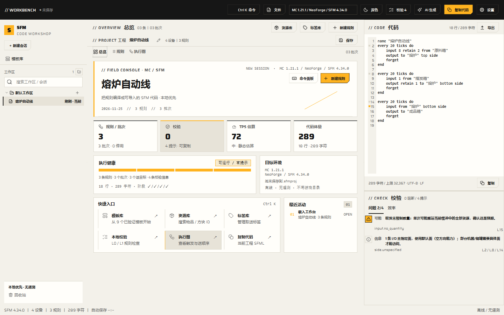
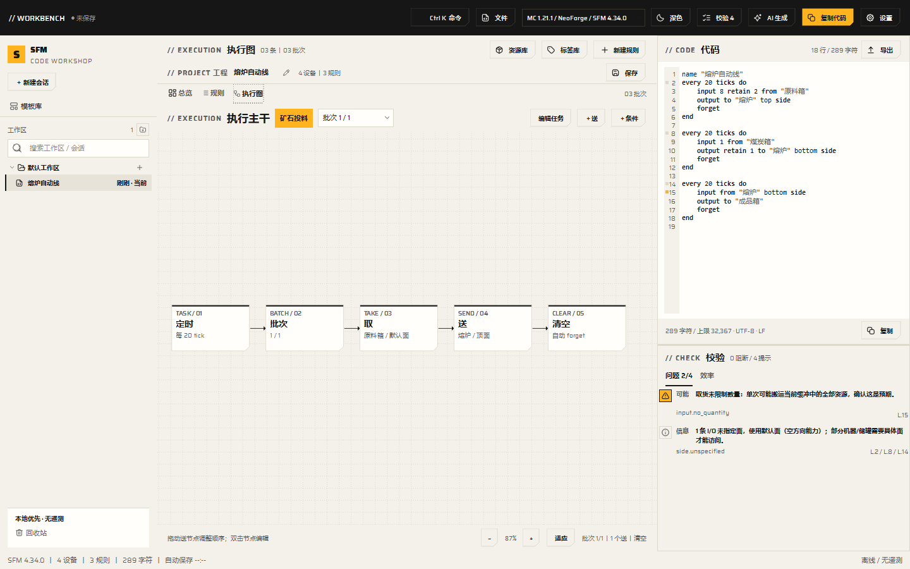

# SFM Code Workshop · SFM 代码工坊

> 面向 Minecraft **Super Factory Manager 4.34.0** 的可视化 SFML 生成器。  
> 不写语法、不改存档：在桌面把“何时、从哪取、送到哪”搭好，复制标准 SFML 进游戏即可。


一个本地优先的 Windows 桌面工具：用任务卡、批次和表格代替手写 SFML；实时生成代码，本地校验，复制或导出 `.sfm`。

> 本项目不是 Super Factory Manager 官方产品，与 TeamDman 及贡献者无隶属关系。

---

## 界面预览

<p align="center">
  
</p>

<p align="center">
  
</p>

---

## 它能做什么

- **零代码搭规则**：一个任务 = 一个触发器；一个批次 = 取 → 送（可多个）→ 清空。
- **多批次任务**：同一触发器下管理多个批次，执行图可切换查看。
- **完整语句支持**：INPUT / OUTPUT / IF / ELSE / FORGET，数量、保留、面、槽位、每方块、标签过滤、空槽。
- **面语义清晰**：默认面 / 每个面 / 上下面 / 东西南北 / 前后左右，前后左右相对方块 facing，不是玩家视角。
- **实时预览与校验**：官方 4.34 ANTLR 文法 L0 + 本地语义 L1；复制前拦截常见错误，问题可点击定位。
- **执行图**：查看触发与送顺序，支持缩放、适应、批次切换、添加送目标与条件编辑。
- **模板库**：8 个可运行模板（熔炉、燃料、树场、蜜蜂分拣、矿物分拣、流体、能量、红石）+ 用户模板导入/导出。
- **工作区与会话**：多工作区、多 `.sfmproj` 会话、独立撤销/保存；会话可重命名、排序、删除到应用回收站。
- **资源库**：内置常用物品；支持中文名、拼音全拼、拼音首字母、完整 ID、标签搜索；可导入游戏内 `/sfm export_info false` 生成的 `items.json`。
- **标签库**：新增 / 重命名 / 删除标签；重命名会同步任务引用。
- **交付方式**：一键复制、导出 `.sfm`、保存 `.sfmproj`、自动保存与恢复提示。
- **可选 AI**：默认关闭；配置 Key 后才联网；候选必须通过本地 L0/L1 才能复制/另存，不自动改工程。
- **本地优先**：无遥测；日志、工程、模板、凭据都在本机用户目录；不写游戏存档 / NBT。

---

## 快速开始

### 方式一：下载 Release

1. 打开右侧 **Releases**，下载 `SFMCodeWorkshop-v0.2.0-win64.zip`。
2. 解压到任意可写目录。
3. 双击 `SFMCodeWorkshop.exe`。

支持 Windows 10 / 11；便携版，不需要安装 Python。

### 方式二：从源码运行

```powershell
git clone https://github.com/Makobrs/SFMCodeWorkshop.git
cd SFMCodeWorkshop

py -3.12 -m venv .venv
.venv\Scripts\python -m pip install -U pip
.venv\Scripts\python -m pip install -r requirements.txt

.venv\Scripts\python -m sfm_workshop
```

> 也可以直接下载仓库源码 ZIP。

自检：

```powershell
.venv\Scripts\python -m sfm_workshop --self-test
```

---

## 构建 Windows 便携包

```powershell
.venv\Scripts\python -m pip install -r requirements-dev.txt
.\build_workshop.bat
```

产物：

```text
dist/SFMCodeWorkshop/SFMCodeWorkshop.exe
dist/SFMCodeWorkshop-v0.2.0-win64.zip
```

---

## 测试

```powershell
.venv\Scripts\python -m pytest -q
```

当前测试：**216 passed，1 skipped**，覆盖模型、生成器、解析/校验、模板、资源库、工作区、会话、导入导出、AI 凭据、UI 冒烟与回归路径。

---

## 项目结构

```text
sfm_workshop/
├─ core/        # 模型、存储、生成、校验、模板、TPS、资源库
├─ grammar/     # 官方 4.34 文法生成的 Python 解析器
├─ services/    # 可选 AI 客户端、提示词、本机凭据
├─ ui/          # PySide6 工作台、执行图、对话框
└─ resources/   # 模板、字体、图标、内置物品目录、第三方许可

tests/          # pytest
docs/           # 截图与说明
build_workshop.ps1
sfm_workshop.spec
```

---

## 已知边界

- 目标为 **SFM 4.34.0**；4.35/main 的 `LET`、`CREATE`、`BROADCAST`、`RENDER IMAGE`、`EVERY FRAME` 等暂不支持。
- TPS 为静态估算，不采集游戏数据，不等同于真实游戏内 TPS。
- 不直接写世界存档/NBT，不修改游戏实例；通过剪贴板或 `.sfm` 交付。
- AI 功能可选且有网络依赖；默认关闭。AI 候选不会自动应用。
- 本地 L0/L1 通过不代表游戏内运行一定成功，仍建议在目标整合包内验收。
- 当前主要面向 Windows 桌面。

---

## 贡献

欢迎 Issue、PR 和模板分享。

提交前请：

1. 运行 `pytest -q`；
2. 不要提交用户工程、日志、AI Key、`.env` 或个人路径；
3. UI 改动附截图或录屏；
4. 保持“本地优先、可离线、无遥测”。

---

## 许可与致谢

- 本项目代码以 **MPL-2.0** 发布，见 [LICENSE](LICENSE)。
- SFML 4.34.0 文法与生成解析器来自 [TeamDman/SuperFactoryManager](https://github.com/TeamDman/SuperFactoryManager)，按 MPL-2.0 使用。
- 字体 Saira（OFL-1.1）、pypinyin（MIT）、Qt/PySide6（LGPL-3.0）等第三方许可见 [NOTICE.md](NOTICE.md) 与 `sfm_workshop/resources/licenses/`。
- 本项目不包含 Minecraft / SFM 游戏资源或模组 jar。

---

**English**

SFM Code Workshop is a local-first Windows desktop app that turns “when / take / send” into valid SFML for Super Factory Manager 4.34.0. Build rules visually, validate locally, copy or export `.sfm`. Optional AI is off by default. Licensed under MPL-2.0.

